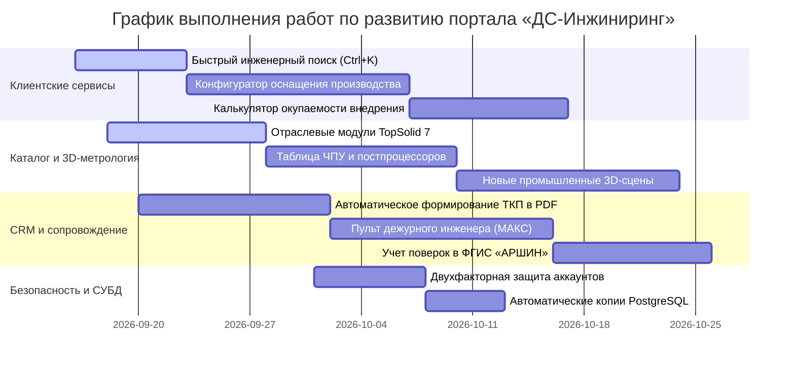

# ПЛАН РАЗВИТИЯ И ДОРАБОТОК ПОРТАЛА
## Корпоративный портал и инжиниринговая платформа ООО «ДС-Инжиниринг»

**Дата актуализации:** 15 сентября 2026 г.  
**Текущая версия системы:** v2.9.47-ПРОМ  
**Статус:** В непрерывной разработке и расширении возможностей  
**Соответствие нормативным требованиям РФ:** 152-ФЗ («О персональных данных»), 242-ФЗ (локализация баз данных в РФ), 168-ФЗ, ГОСТ Р 57188, ГОСТ ISO/IEC 17025, ФГИС «АРШИН», реестр Минпромторга РФ.

---

## 🎯 СТРАТЕГИЧЕСКИЕ НАПРАВЛЕНИЯ РАЗВИТИЯ

План развития цифровой платформы **ООО «ДС-Инжиниринг»** сформирован с учетом специфики отечественного машиностроения, предприятий оборонно-промышленного комплекса (ОПК), авиастроения, приборостроения, инструментального производства, а также требований метрологических служб и отделов технического контроля (ОТК).

Ключевой приоритет — импортоопережение, повышение точности измерений, сокращение времени подготовки управляющих программ для станков с числовым программным управлением (ЧПУ) и ускорение согласования коммерческих и технических предложений.

---

## 📋 ПЛАН ДОРАБОТОК ПО РАЗДЕЛАМ

### РАЗДЕЛ 1: Удобство взаимодействия, интерфейс и клиентские сервисы

| № | Задача | Описание реализации | Приоритет | Статус |
|---|---|---|---|---|
| 1.1 | **Быстрый инженерный поиск по каталогу и нормативной базе (`Ctrl+K` / `Cmd+K`)** | Всплывающее окно мгновенного поиска по всему перечню измерительного оборудования, программным комплексам, ГОСТам, методикам измерений и статьям Базы знаний с фильтрацией по отраслям. | 🔴 Высокий | ⏳ Запланировано |
| 1.2 | **Интерактивный конфигуратор комплексного оснащения цеха и лаборатории** | Пошаговый подбор связки «САПР/ЧПУ TopSolid + Метрология PolyWorks + Координатно-измерительная машина (КИМ) / 3D-сканер + Разработка постпроцессоров + Обучение персонала» с формированием официальной спецификации. | 🔴 Высокий | ⏳ Запланировано |
| 1.3 | **Инженерно-экономический калькулятор эффективности и окупаемости** | Расчет экономической выгоды: сокращение машинного времени при 5-осевой обработке деталей, снижение брака и ускорение контроля геометрии первой детали (ОТК) с наглядным графиком окупаемости в рублях. | 🟡 Средний | ⏳ Запланировано |
| 1.4 | **Реестр типовых протоколов входного и выходного контроля деталей** | Интерактивные образцы протоколов контроля точности по ГОСТ и картам отклонений формы и взаимного расположения поверхностей с возможностью детального просмотра в браузере. | 🟡 Средний | ⏳ Запланировано |
| 1.5 | **Автономный доступ и сервисные оповещения (отечественные каналы)** | Поддержка работы в закрытом контуре предприятия без постоянного выхода в интернет, оповещения о статусе заявок через защищенный российский мессенджер МАКС и Telegram. | 🟢 Базовый | ⏳ Запланировано |

---

### РАЗДЕЛ 2: Каталог программного обеспечения, оборудования и 3D-метрология

| № | Задача | Описание реализации | Приоритет | Статус |
|---|---|---|---|---|
| 2.1 | **Отраслевые страницы специализированных модулей TopSolid 7** | Развертывание подробных разделов: проектирование изделий и сборок (`TopSolid'Design`), 2D–5D фрезерная, токарная и эрозионная обработка (`TopSolid'Cam`), проектирование пресс-форм (`TopSolid'Mold`), штампы последовательного действия (`TopSolid'Progress`), деревообработка (`TopSolid'Wood`). | 🔴 Высокий | ⏳ Запланировано |
| 2.2 | **Интерактивная таблица совместимости систем ЧПУ и постпроцессоров** | База готовых кинематических 3D-моделей станков и проверенных постпроцессоров для отечественных и зарубежных систем управления (Балт-Систем, Маяк, Fanuc, Siemens Sinumerik, Heidenhain, Syntec). | 🔴 Высокий | ⏳ Запланировано |
| 2.3 | **Пополнение библиотеки отечественных промышленных 3D-образцов** | Интеграция в трехмерный просмотрщик новых реальных деталей: лопатка газотурбинного двигателя с цветовой картой погрешностей, пресс-форма с сечением секущей плоскостью, корпус редуктора (полигональная сетка оптического сканирования). | 🟡 Средний | ⏳ Запланировано |
| 2.4 | **Сравнение технических характеристик СИ и сканеров** | Инструмент построчного сопоставления параметров измерительных приборов (предел допускаемой погрешности, диапазон измерений, номер в Госреестре СИ РФ, скорость сбора точек, мобильность). | 🟡 Средний | ⏳ Запланировано |
| 2.5 | **Безопасный просмотр чертежей и моделей заказчика (без передачи на внешние серверы)** | Локальная обработка файлов форматов STEP, IGES, STL прямо в браузере инженера с соблюдением требований конфиденциальности и соглашений о неразглашении (NDA). | 🟡 Средний | ⏳ Запланировано |

---

### РАЗДЕЛ 3: Управление взаимоотношениями с клиентами (CRM) и ведение договоров

| № | Задача | Описание реализации | Приоритет | Статус |
|---|---|---|---|---|
| 3.1 | **Автоматическое формирование коммерческих и технических предложений (ТКП)** | Выгрузка официального бланка коммерческого предложения в формате PDF с реквизитами заказчика по ИНН, логотипом «ДС-Инжиниринг», факсимиле подписи, печатью, спецификацией и условиями поставки по 44-ФЗ / 223-ФЗ. | 🔴 Высокий | ⏳ Запланировано |
| 3.2 | **Единый пульт дежурного инженера и обработка обращений** | Двухсторонняя связь с клиентами: прием вопросов и заявок из чат-бота в российском мессенджере МАКС, Telegram и с сайта в едином окне системы ведения сделок. | 🔴 Высокий | ⏳ Запланировано |
| 3.3 | **Учет сроков технической поддержки и поверок в ФГИС «АРШИН»** | Автоматический график планового продления годового сопровождения ПО, планового технического обслуживания КИМ и поверок средств измерений в аккредитованных лабораториях. | 🟡 Средний | ⏳ Запланировано |
| 3.4 | **Калькулятор себестоимости выездных измерений и внедрения** | Встроенный расчет сметы: командировочные расходы инженеров-метрологов, транспортная страховка оборудования, трудоемкость разработки индивидуальных постпроцессоров. | 🟡 Средний | ⏳ Запланировано |
| 3.5 | **Календарно-сетевой график выездов и пусконаладочных работ** | Планирование выездных демонстраций 3D-сканеров, лазерных трекеров, проведения замеров крупногабаритных деталей и обучения операторов на заводах заказчиков. | 🟢 Базовый | ⏳ Запланировано |

---

### РАЗДЕЛ 4: Панель администрирования контента (CMS) и поисковая оптимизация

| № | Задача | Описание реализации | Приоритет | Статус |
|---|---|---|---|---|
| 4.1 | **Массовая загрузка каталога через электронные таблицы (Excel / МойСклад)** | Пакетный импорт и выгрузка номенклатуры, актуальных рублевых цен, остатков на складе и технических паспортов из файлов XLSX / CSV. | 🔴 Высокий | ⏳ Запланировано |
| 4.2 | **Мониторинг доступности страниц и соответствия стандартам поисковой оптимизации** | Встроенная автоматическая проверка сайта: контроль корректности внутренних адресов, микроразметки для поисковых систем Яндекс и Mail.ru, проверка доступности контактов. | 🟡 Средний | ⏳ Запланировано |
| 4.3 | **История версий и журнал правок страниц** | Возможность мгновенного восстановления предыдущей версии описания станка, услуги или статьи в случае случайного изменения редактором. | 🟢 Базовый | ⏳ Запланировано |

---

### РАЗДЕЛ 5: Информационная безопасность, серверная часть и база данных

| № | Задача | Описание реализации | Приоритет | Статус |
|---|---|---|---|---|
| 5.1 | **Двухфакторное подтверждение входа сотрудников** | Защищенный вход в систему администрирования и учетную запись через отечественные генераторы одноразовых кодов (Яндекс.Ключ) и СМС. | 🔴 Высокий | ⏳ Запланировано |
| 5.2 | **Автоматическое резервное копирование СУБД PostgreSQL на защищенный сервер** | Ежесуточное создание зашифрованных копий базы данных с глубиной архива 30 дней и размещением в изолированном контуре на территории Российской Федерации. | 🔴 Высокий | ⏳ Запланировано |
| 5.3 | **Оптимизация трехмерной графики для отечественных рабочих станций и ОС** | Адаптивная детализация трехмерных моделей для комфортной работы специалистов на отечественных операционных системах (Astra Linux, РЕД ОС, Альт Линукс) без дискретных видеокарт. | 🟡 Средний | ⏳ Запланировано |
| 5.4 | **Связка с корпоративной АТС (MANGO Office / Ростелеком / Asterisk)** | Всплывающая карточка предприятия при входящем звонке, фиксация разговора и автоматическое назначение ответственного инженера по направлению. | 🟡 Средний | ⏳ Запланировано |

---

## 📅 КАЛЕНДАРНЫЙ ПЛАН ВНЕДРЕНИЯ

---

## 📌 ПОРЯДОК УТВЕРЖДЕНИЯ И ПРИЕМКИ РАБОТ
1. Технические инициативы регистрируются главным инженером или руководителем проектов ООО «ДС-Инжиниринг».
2. После утверждения приоритета задача переходит в статус `⏳ Запланировано`.
3. В процессе выполнения статус меняется на `🔄 В работе`, а после успешного тестирования и ввода в промышленную эксплуатацию — на `✅ Выполнено` с обязательным внесением записей в **`docs/CHANGELOG.md`** и **`docs/SITE_PASSPORT.md`**.
