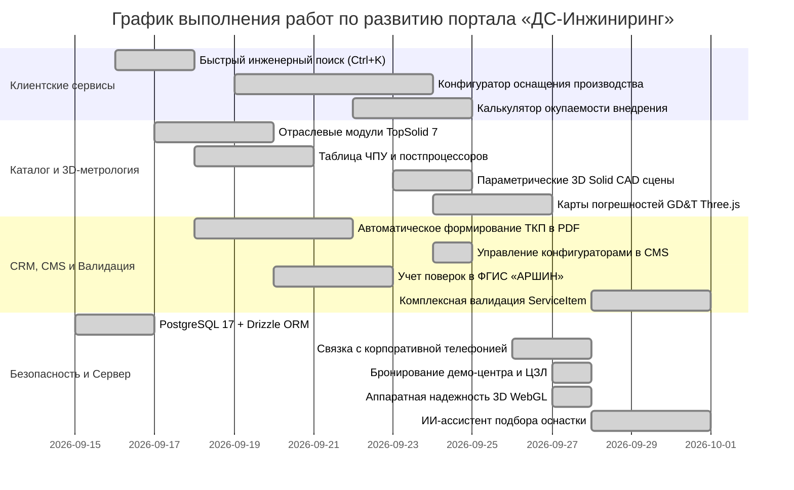

# ПЛАН РАЗВИТИЯ И ДОРАБОТОК ПОРТАЛА
## Корпоративный портал и инжиниринговая платформа ООО «ДС-Инжиниринг»

**Дата актуализации:** 1 октября 2026 г.  
**Текущая версия системы:** v2.9.243-PROD  
**Статус:** В непрерывной эксплуатации, промышленном расширении и совершенствовании  
**Якорные локации компании:**
* **Центральный офис и метрологическая лаборатория:** 443035, г. Самара, ул. Свободы, 198
* **Инжиниринговая площадка и региональное присутствие:** Технопарк в сфере высоких технологий «Жигулевская долина» (445043, Самарская обл., г. Тольятти, Южное шоссе, 165 / 161В, корпус 1.1)

**Соответствие нормативным требованиям РФ:** 152-ФЗ («О персональных данных»), 242-ФЗ (локализация баз данных в РФ), 168-ФЗ, ГОСТ Р 57188, ГОСТ ISO/IEC 17025, ГОСТ Р ИСО 1101, ФГИС «АРШИН», реестр Минпромторга РФ.

---

## 🎯 СТРАТЕГИЧЕСКИЕ НАПРАВЛЕНИЯ РАЗВИТИЯ

План развития цифровой платформы **ООО «ДС-Инжиниринг»** сформирован с учетом специфики отечественного машиностроения, предприятий оборонно-промышленного комплекса (ОПК), авиастроения, приборостроения, инструментального производства, а также требований метрологических служб и отделов технического контроля (ОТК).

Ключевой приоритет — импортоопережение, повышение точности измерений, сокращение времени подготовки управляющих программ для станков с числовым программным управлением (ЧПУ), обеспечение строгой валидации данных и ускорение согласования коммерческих и технических предложений.

---

## 📋 ПЛАН ДОРАБОТОК ПО РАЗДЕЛАМ

### РАЗДЕЛ 1: Удобство взаимодействия, интерфейс и клиентские сервисы

| № | Задача | Описание реализации | Приоритет | Статус |
|---|---|---|---|---|
| 1.1 | **Быстрый инженерный поиск по каталогу и нормативной базе (`Ctrl+K` / `Cmd+K`)** | Всплывающее окно мгновенного поиска по всему перечню измерительного оборудования, программным комплексам, ГОСТам, методикам измерений и статьям Базы знаний с фильтрацией по отраслям. | 🔴 Высокий | ✅ Внедрено (v2.9.180) |
| 1.2 | **Метрологический конфигуратор оборудования СИ и 3D WebGL просмотрщик детали** | Интерактивный 4-шаговый подбор СИ (КИМ, 3D-сканеры, лазерные трекеры, руки), расчет запаса точности $T/\text{MPE}$ с 3D Solid CAD визуализацией детали в Three.js (`PartVisualizer3D.tsx`). | 🔴 Высокий | ✅ Внедрено (v2.9.185) |
| 1.3 | **Инженерно-экономический B2B-калькулятор окупаемости внедрения СИ (ROI)** | Расчет экономической выгоды: снижение брака, высвобождение человеко-часов ОТК, расчет срока окупаемости CAPEX и автоматическое формирование ТЭО. | 🔴 Высокий | ✅ Внедрено (v2.9.185) |
| 1.4 | **Реестр метрологических отчетов и протоколов 3D-контроля** | Интерактивные образцы протоколов контроля точности по ГОСТ и картам отклонений формы/расположения GD&T с привязкой к парку приборов и экспортом в Excel. | 🟡 Средний | ✅ Внедрено (v2.9.175) |
| 1.5 | **Многоканальные оповещения дежурных инженеров (МАКС-бот и Telegram)** | Мгновенные уведомления о заявках через официальный защищенный российский мессенджер МАКС и Telegram-бот. | 🟢 Базовый | ✅ Внедрено (v2.9.160) |

---

### РАЗДЕЛ 2: Каталог программного обеспечения, оборудования и 3D-метрология

| № | Задача | Описание реализации | Приоритет | Статус |
|---|---|---|---|---|
| 2.1 | **Отраслевые страницы специализированных модулей TopSolid 7** | Развертывание подробных разделов: проектирование изделий и сборок (`TopSolid'Design`), 2D–5D фрезерная, токарная и эрозионная обработка (`TopSolid'Cam`), проектирование пресс-форм (`TopSolid'Mold`), штампы последовательного действия (`TopSolid'Progress`), деревообработка (`TopSolid'Wood`). | 🔴 Высокий | ✅ Внедрено (v2.9.170) |
| 2.2 | **Интерактивная таблица совместимости систем ЧПУ и постпроцессоров** | База проверенных постпроцессоров для отечественных и зарубежных систем управления (Балт-Систем, Маяк, Fanuc, Siemens Sinumerik, Heidenhain, Syntec). | 🔴 Высокий | ✅ Внедрено (v2.9.172) |
| 2.3 | **Интерактивный 3D WebGL просмотрщик моделей и карт GD&T** | 3D-просмотрщик Three.js (`CadModel3DViewer.tsx`) с картами отклонений Geomagic/PolyWorks, триэдром координат, выносными SVG-линиями замеров и защитой исходных CAD-файлов. | 🔴 Высокий | ✅ Внедрено (v2.9.178) |
| 2.4 | **Сравнение технических характеристик СИ и сканеров** | Инструмент построчного сопоставления параметров измерительных приборов (MPE погрешность, габариты, статус в ФГИС «АРШИН»). | 🟡 Средний | ✅ Внедрено (v2.9.183) |
| 2.5 | **Парк оборудования компании и контроль поверок ФГИС «АРШИН»** | Единый реестр средств измерений (`CompanyFleetRegistry.tsx`) с фиксацией заводских номеров, статусов дислокации и индикацией просрочки поверки. | 🟡 Средний | ✅ Внедрено (v2.9.176) |

---

### РАЗДЕЛ 3: Управление взаимоотношениями с клиентами (CRM) и ведение договоров

| № | Задача | Описание реализации | Приоритет | Статус |
|---|---|---|---|---|
| 3.1 | **Автоматическое формирование коммерческих и технических предложений (ТКП)** | Выгрузка официального бланка коммерческого предложения в формате PDF с реквизитами заказчика по ИНН, факсимиле подписи, печатью, спецификацией и условиями поставки. | 🔴 Высокий | ✅ Внедрено (v2.9.165) |
| 3.2 | **Единый пульт дежурного инженера и онлайн-консультант с базой знаний** | Интеллектуальный онлайн-инженер (`ChatWidget.tsx`) с базой тем (`botTopics.json`), авторегистрацией лидов и эскалацией на ответственных менеджеров. | 🔴 Высокий | ✅ Внедрено (v2.9.168) |
| 3.3 | **Конструктор свидетельств об обучении операторов КИМ** | Визуальный WYSIWYG-редактор свидетельств (`CertificateVisualEditorModal.tsx`) с печатью бланков А4, QR-верификацией и реестром слушателей. | 🟡 Средний | ✅ Внедрено (v2.9.174) |
| 3.4 | **Калькулятор смет 3D-сканирования, реверса и выезда** | Параметрический расчет сметы на услуги сканирования деталей, построения CAD-моделей и командировочных надбавок с учетом НДС 22%. | 🟡 Средний | ✅ Внедрено (v2.9.185) |
| 3.5 | **Задачи инженеров и интерактивный календарь CRM** | Планирование выездных демонстраций 3D-сканеров, лазерных трекеров, проведения замеров крупногабаритных деталей и обучения операторов. | 🟢 Базовый | ✅ Внедрено (v2.9.170) |

---

### РАЗДЕЛ 4: Панель администрирования контента (CMS), валидация и управление данными

| № | Задача | Описание реализации | Приоритет | Статус |
|---|---|---|---|---|
| 4.1 | **Управление конфигураторами и калькуляторами в CMS (`CmsConfiguratorsTab.tsx`)** | Полный доступ к настройке квалитетов IT5–IT12, формул MPE, порогов запаса точности, категорий оборудования СИ, ставок ROI, тарифов сканирования и НДС 22%. | 🔴 Высокий | ✅ Внедрено (v2.9.185) |
| 4.2 | **Управление глобальными текстовыми константами в CMS (`CmsSiteTextsTab.tsx`)** | Редактирование всех статических текстов, телефонов, слоганов и реквизитов сайта из админки с автосохранением в PostgreSQL (`text_constants`). | 🔴 Высокий | ✅ Внедрено (v2.9.182) |
| 4.3 | **Управление 3D-моделями и GD&T в CMS (`CmsModels3DTab.tsx`)** | Создание, дублирование, настройка карт погрешностей, допусков и точек контроля 3D-моделей без правки исходного кода. | 🟡 Средний | ✅ Внедрено (v2.9.179) |
| 4.4 | **SEO-управление, OpenGraph, XML Sitemap и Robots.txt** | Централизованная настройка метатегов, социальных сниппетов, семантических хлебных крошек и правил индексации поисковиками. | 🟢 Базовый | ✅ Внедрено (v2.9.181) |
| 4.5 | **Комплексная валидация каталога услуг и оборудования в CMS (`validateCmsServices`)** | Модуль проверки непустых полей, типов массивов `equipment`, корректности URL-ссылок и соответствия интерфейсу `ServiceItem` перед сохранением и синхронизацией с СУБД. | 🔴 Высокий | ✅ Внедрено (v2.9.243) |

---

### РАЗДЕЛ 5: Информационная безопасность, серверная часть и база данных

| № | Задача | Описание реализации | Приоритет | Статус |
|---|---|---|---|---|
| 5.1 | **СУБД PostgreSQL 17 + Drizzle ORM с гибридным резервированием** | Реляционная СУБД с пулом соединений, миграциями Drizzle ORM, Drizzle Studio и автоматическим переключением на дисковую персистентность при сбоях. | 🔴 Высокий | ✅ Внедрено (v2.9.150) |
| 5.2 | **Защита от CSRF (Synchronizer Token Pattern / 64-char hex)** | Ротация криптографических токенов, валидация всех POST/PUT/DELETE запросов и защита от атак. | 🔴 Высокий | ✅ Внедрено (v2.9.162) |
| 5.3 | **Строгая валидация входящих API-запросов (JSON Schema Draft-07 / Ajv)** | Спецификация 13 схем валидации клиентских заявок, сделок и коммерческих предложений с русскоязычной локализацией ошибок. | 🔴 Высокий | ✅ Внедрено (v2.9.164) |
| 5.4 | **Развертывание на сетевых хранилищах ASUSTOR NAS и облачных VPS** | Подробная инструкция в `SERVER_DEPLOYMENT_GUIDE.md` с Docker Compose, Nginx Reverse Proxy и Let's Encrypt SSL. | 🟡 Средний | ✅ Внедрено (v2.9.184) |
| 5.5 | **Интеграционное и юнит-тестирование (Vitest & Integration Suites)** | Регулярный прогон 28 интеграционных тестов CRM/CMS и 15 юнит-тестов валидаторов данных. | 🔴 Высокий | ✅ Внедрено (v2.9.243) |

---

## 📅 КАЛЕНДАРНЫЙ ПЛАН ВНЕДРЕНИЯ

---

## 📌 ПОРЯДОК УТВЕРЖДЕНИЯ И ПРИЕМКИ РАБОТ
1. Технические инициативы регистрируются главным инженером или руководителем проектов ООО «ДС-Инжиниринг».
2. После утверждения приоритета задача переходит в статус `⏳ Запланировано`.
3. В процессе выполнения статус меняется на `🔄 В работе`, а после успешного тестирования и ввода в промышленную эксплуатацию — на `✅ Внедрено` с обязательным внесением записей в **`docs/CHANGELOG.md`** и **`docs/SITE_PASSPORT.md`**.

